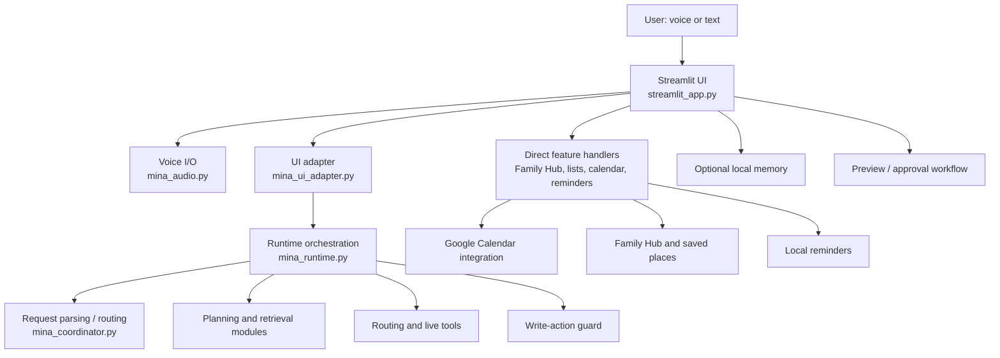

# MINA — System Architecture

**Project:** MINA — My Intelligent Navigation Assistant
**Reference version:** v2.15.4
**Status:** Final Integrated and Validated Prototype (research/educational prototype)
**Basis:** Static inspection of `MINA_CODE_AUDIT.zip` (149 selected files). This document does not certify a clean install, live API connectivity, or runtime behavior.

## 1. Overview

MINA is a modular Python application with a Streamlit interface for family planning and coordination. It supports voice/text interaction, family lists, calendar workflows, location-aware planning, local reminders, and optional local conversation memory. Its capabilities depend on configuration, external services, and the type of user request.

The implementation has **multiple execution paths**: some interactions are handled directly in `streamlit_app.py` using specialized modules; others are delegated through `mina_ui_adapter.py` into `mina_runtime.py` and `mina_coordinator.py`. It would be inaccurate to describe every UI action as passing through one universal agent loop.

## 2. High-level component map



*This is a conceptual map of inspected imports and functionality, not a full trace of every runtime branch.*

## 3. Component inventory

| Area | Main modules | Responsibility indicated by code |
| --- | --- | --- |
| Presentation and session state | `streamlit_app.py`, `mina_dashboard.py`, `mina_chat_input.py`, CSS files | Streamlit screens, user interactions, and session state |
| Voice | `mina_audio.py` | Audio transcription and spoken-reply generation through configured services |
| UI/runtime bridge | `mina_ui_adapter.py` | Validates UI settings and invokes runtime request handling |
| Request coordination | `mina_runtime.py`, `mina_coordinator.py`, `complexity_router.py`, `mina_state.py` | Request handling, coordination, state and routing decisions |
| Planning | `mina_planning.py`, `mina_live_planning.py`, `tot_planner.py`, `mina_agent_tot_integrated.py` | Planning-related components and experimental/integrated reasoning paths; not every module is necessarily exercised by each UI flow |
| Route and location tooling | `mina_route_tools.py`, `mina_live_routing.py`, `mina_route_routing.py`, `mina_saved_places.py`, `mina_route_schedule_v2125.py`, `mina_route_geocode_v2123.py`, `mina_geocoding_consent_v2142.py` | Place management, route/geocode workflows, scheduling and consent controls |
| Calendar | `mina_calendar_v27.py`, `mina_google_calendar.py` | Calendar data/workflows and Google Calendar API integration |
| Family Hub and lists | `mina_family_hub.py`, `mina_multi_store_v210.py`, `mina_list_removal_v211.py` | Saved family information, shopping/list operations |
| Conversation and follow-ups | `mina_conversation_state_v214.py`, `mina_multiturn_v215.py`, `mina_followups.py` | Multi-turn and follow-up handling |
| Optional local memory | `mina_memory_v215.py` | Local SQLite-backed exchanges, preference opt-in and memory management |
| Reminders | `mina_reminders_v215.py` | Local reminder feature |
| Action safety | `mina_write_guard.py`, UI preview/confirmation functions in `streamlit_app.py` | Write-intent detection and confirmation/cancellation for supported workflows |
| Evaluation | `test_*.py`, `run_offline_checks.py`, `eval_mina.py` | Unit, regression and evaluation utilities of varying vintages |

## 4. Representative execution paths

### 4.1 General request path

1. The user interacts with the Streamlit application (`streamlit_app.py`).
2. For supported requests, the UI passes a validated request via `mina_ui_adapter.execute_ui_request`.
3. `mina_runtime.run_request` coordinates subsequent steps, including the coordinator, planning/retrieval, and tools depending on the request.
4. A response or plan is returned to the interface for display.

Other UI interactions bypass this specific path and directly invoke feature modules; this is intentional to document rather than conceal.

### 4.2 Calendar create flow

The inspected UI includes preview/queue/commit functionality (`_calendar_preview`, `_queue_calendar_action`, `_commit_calendar_action`) and accesses `mina_google_calendar.py`, which provides `list_events` and `insert_event`. A supported write operation should be distinguished from read-only calendar queries, and the user-facing confirmation flow must be tested as a runtime property. This static audit alone does not establish that every possible calendar action is guarded.

### 4.3 Routing and saved places

The UI references saved places, route scheduling, route/geocoding support, explicit geocoding consent, route previews, and live routing. Accurate routing depends on sufficient user-supplied locations/preferences and any required external services. The application should not claim a calculated route when inputs or service access are missing.

### 4.4 Memory and persistence

`mina_memory_v215.py` uses SQLite and exposes opt-in, history, pinned facts, search and erasure operations. Family settings and other features may persist in local JSON files. These local files are **private runtime data**, not public repository assets. Optional memory is not represented as encrypted-at-rest storage in this prototype.

## 5. Dependencies and configuration

The code references Streamlit, OpenAI client libraries, Google Calendar API libraries, local storage, and routing/geocoding functionality. The inspected project has `requirements.txt`, `requirements_ui.txt`, and `requirements_calendar_v2_7.txt`. Dependency reconciliation and a clean-environment install check are pending; do not assume any one file is complete without verification.

Runtime credentials and user data must be provided locally, not committed to GitHub. In particular, exclude `.env`, Google OAuth client credentials and access/refresh tokens, and private `local_data/` files. Review the **actual files staged for Git**, not only `.gitignore` patterns.

## 6. Safety and system boundaries

- Supported write actions use confirmation/preview controls in the UI, with request-level write detection also represented in `mina_write_guard.py`.
- Routing/geocoding features include consent-related code and require validated input/context.
- External API results and availability can fail or change; successful local syntax checks are not equivalent to end-to-end success.
- Local reminders are not a guaranteed background push-notification service.
- This is an educational prototype, not a production-hardened deployment.

## 7. Verification status

**Established from static inspection:** major modules exist; `streamlit_app.py` is an entry point; import relationships show modular architecture; features and relevant safety/memory/calendar functions are present in code.

**Not established by this document:** fresh-install success, complete runtime import resolution (including dynamic imports), API connectivity, a new seven-scenario E2E run, or proof that all guardrails cover every action. Those require test evidence and should be linked from `docs/TESTS.md` and `docs/RESULTS.md`.

## 8. Running entry point

```bash
python -m streamlit run streamlit_app.py
```

Run from the repository root, after installing verified dependencies and supplying the required local environment configuration. A clean-install procedure will be finalized in `docs/INSTALLATION.md` after reproducibility testing.
