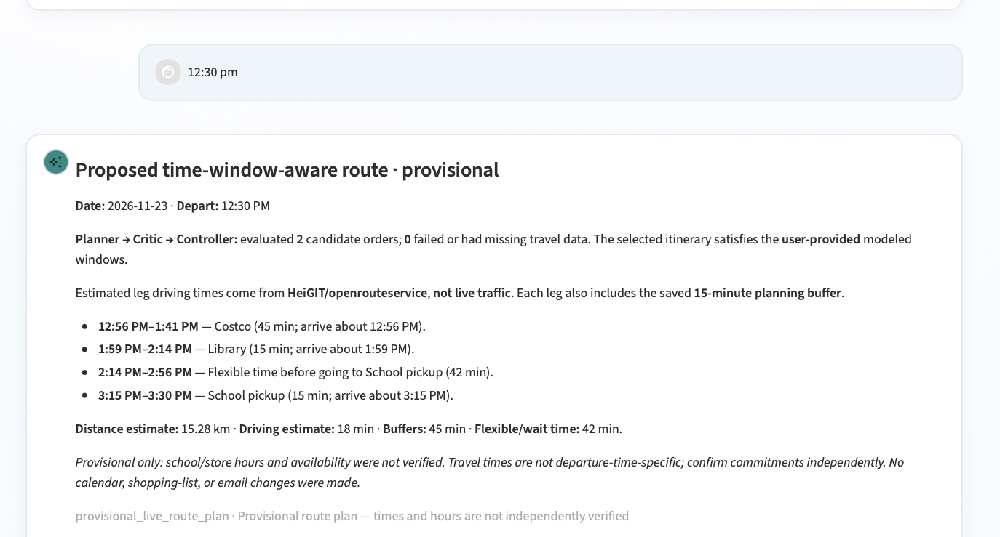
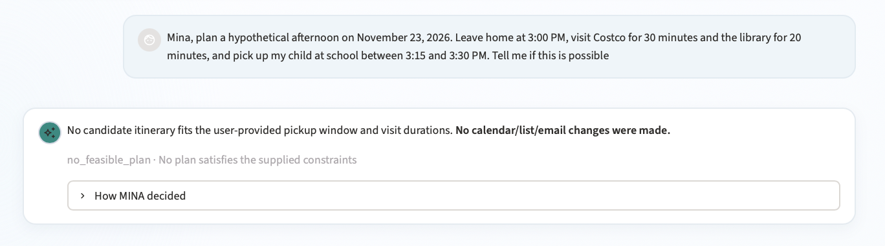
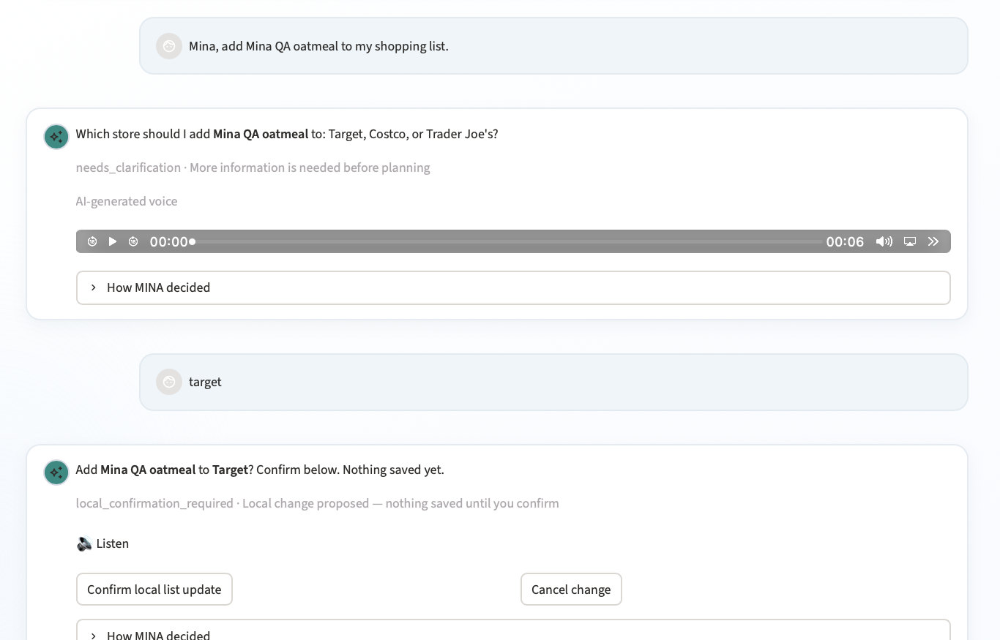
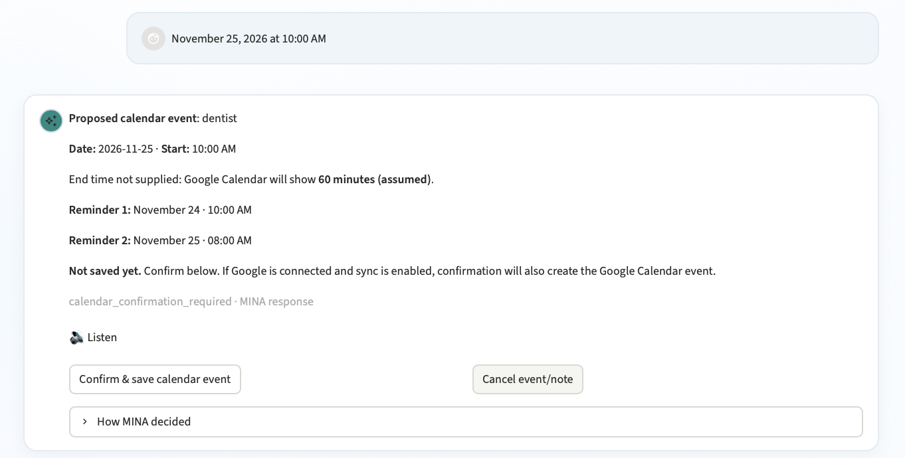
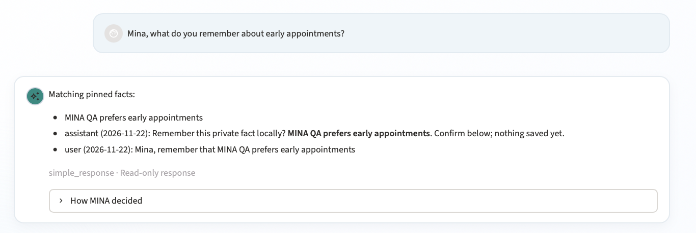
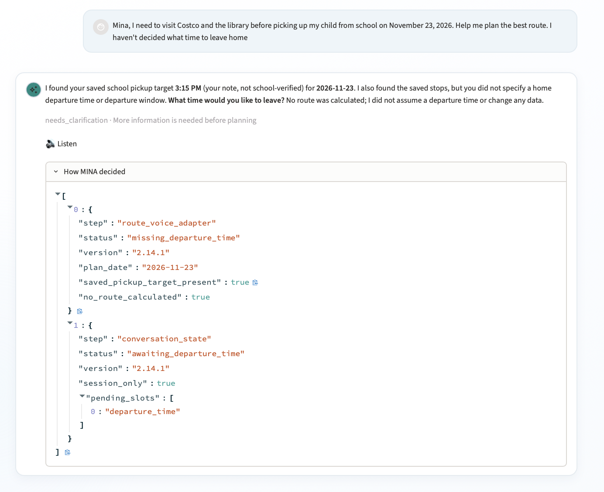
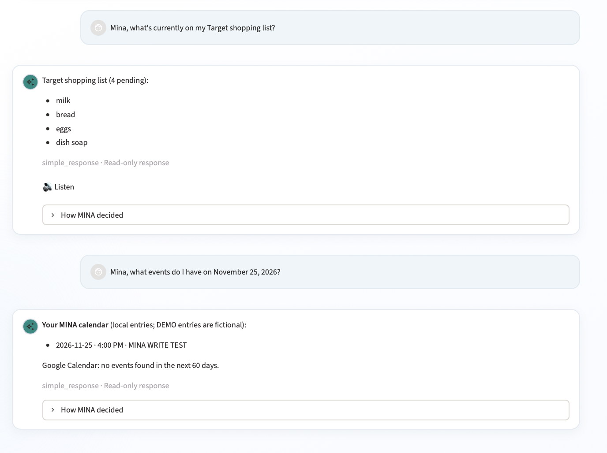

# Appendix A — Evaluation Evidence

**MINA v2.15.4 | November 22, 2026**

**Purpose.** This appendix presents seven selected screenshots of user-observed Streamlit workflows. Figures document specific acceptance tests; they are not seven independent draws from a representative benchmark. Screenshots are curated and may be cropped for legibility; source image files and cropping coordinates are retained in `Evaluation_Appendix_Figures/manifest.json`. No saved-location map is reproduced.

## Figure A1: Multi-turn route continuation and provisional schedule

**Observed.** A request without a departure time caused a targeted clarification. The separate reply “12:30 PM” resumed planning: two candidate orders were evaluated and an itinerary with a 3:15 PM school pickup was proposed.

**Evidence scope.** PASS: supported slot-filling and modeled feasibility. The 42-minute slack and 15-minute per-leg buffers are estimates, not guarantees.

## Figure A2: Fail-closed response to an infeasible route

**Observed.** A 3:00 PM departure with 50 minutes of requested stops and a 3:15–3:30 PM pickup window produced “no_feasible_plan,” rather than an invented feasible route.

**Evidence scope.** PASS: rejection under the stated modeled constraints. This does not validate real-time driving conditions.

## Figure A3: Shopping list: clarification and approval gate

**Observed.** MINA requested the missing store for a synthetic oatmeal item. After the user replied “target,” it displayed a local write proposal and Confirm/Cancel controls.

**Evidence scope.** PASS: the write was proposed, not silently executed. The later readback excluded the QA item.

## Figure A4: Calendar: date/time slot filling and write preview

**Observed.** A dentist request was clarified with “November 25, 2026 at 10:00 AM”; MINA displayed a proposed event, assumed 60-minute duration, and Confirm/Cancel controls.

**Evidence scope.** PASS: the proposal required confirmation. The screenshot does not prove a live Google write; the event was canceled.

## Figure A5: Persistent local memory retrieval

**Observed.** After the reported application restart, MINA retrieved the confirmed synthetic fact “MINA QA prefers early appointments,” together with related history messages.

**Evidence scope.** PASS for saved-fact retrieval in this test. Duplicated intermediary messages illustrate a relevance/noise limitation.

## Figure A6: Fresh-session saved-setting recovery and trace

**Observed.** After a fresh Streamlit restart without re-saving Family Hub, MINA found the saved 3:15 PM pickup and traced the single missing slot as “departure_time.”

**Evidence scope.** PASS for this regression. The earlier intermittent stale-state issue was not fully root-caused.

## Figure A7: Post-cancellation readback of shopping and calendar

**Observed.** The Target list still contained milk, bread, eggs and dish soap, with no QA oatmeal. The calendar read did not show the canceled 10:00 AM dentist test.

**Evidence scope.** PASS for app-level readback. A pre-existing local “MINA WRITE TEST” at 4:00 PM remained; a separate Google Calendar UI audit was not performed.

## Evaluation note

The screenshots support specific pass/fail observations and UI behavior, not statistical success rates or independent verification of third-party services. Report proposed target metrics separately from measured outcomes.
